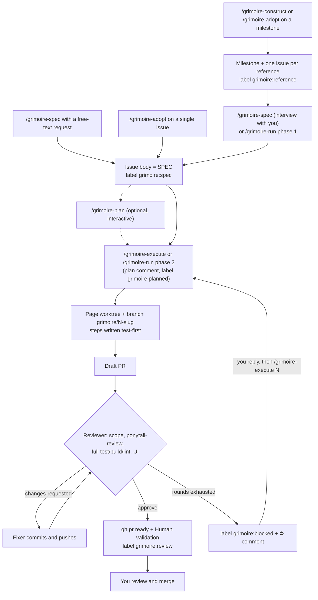
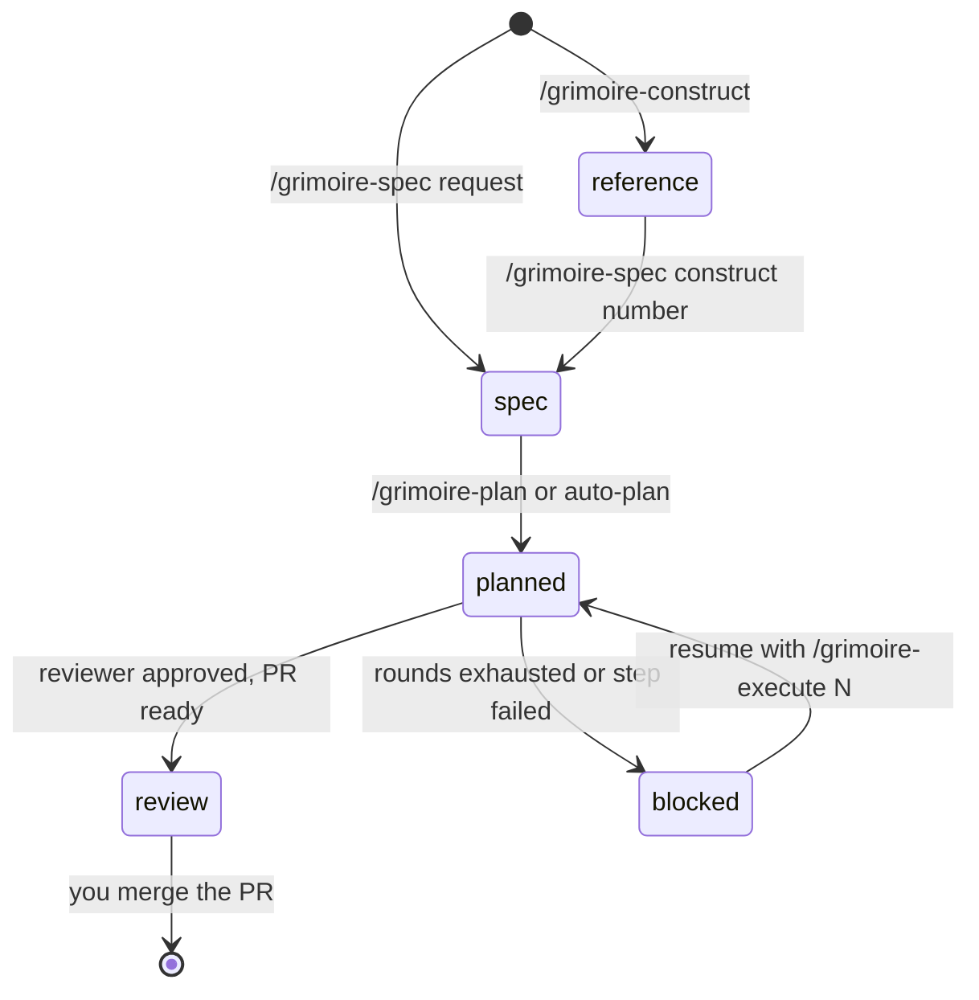

<div align="center">


# Grimoire

**English** · [Português (Brasil)](README.pt-BR.md)

</div>

Grimoire is a set of thirteen skills for **Claude Code** and **Codex** that run a disciplined **Spec → Plan → Execute** workflow. You stay in the loop where it matters — the spec interview — and from there Grimoire plans the work, implements it test-first on its own branch in an isolated worktree, and drives an **autonomous review loop** (a reviewer and a fixer, round after round) that ends in a pull request waiting for **your** review. `grimoire-run` does the same for a whole **construct** — a larger objective split into ordered pages — interviewing you first and then running every page on its own. Workflow state lives in **GitHub milestones, issues, and pull requests** — never committed into your repository (a git-ignored local mode covers repositories without GitHub).

> [!WARNING]
> **Early development.** Grimoire works for the author's day-to-day sessions but has not been battle-tested across many projects or teams. Expect rough edges and breaking changes between minor versions. Issues and PRs are very welcome.

## Why Grimoire

I built Grimoire because other context orchestrators kept giving me mediocre output — too heavy, too chatty, and too eager to take decisions away from me. The result was usually a project that drifted from what I actually wanted.

Grimoire is the opposite. It asks until **you** are clear on what you want, then ships exactly that: every page starts with an interview that ends in an agreed specification, and every choice the planner makes on its own is written down as an assumption you can read in the plan. Once the specification is agreed, the rest is autonomous — plan, test-first implementation, review, fixes — and stops at a pull request with a **Human validation** section listing what you still have to check by hand. Grimoire never merges for you.

**It is not for non-technical users.** It assumes you can read code, evaluate a plan, and own the decisions it surfaces.

> Every change Grimoire tracks is a **page** — on GitHub, an issue whose body is the specification and whose work ships as one pull request. An objective too big for one page is a **construct** — a milestone whose issues are ordered **references**, each later specified into a page.

## Install

**macOS, Linux, Git Bash:**

```sh
curl -fsSL https://raw.githubusercontent.com/ojCezarFerreira/grimoire/main/install.sh | sh
```

Pass flags after `sh -s --`, for example `… | sh -s -- --agent codex --no-deps`.

**Windows PowerShell** (needs [Git for Windows](https://git-scm.com/download/win); the script runs `install.sh` through its `bash.exe`):

```powershell
irm https://raw.githubusercontent.com/ojCezarFerreira/grimoire/main/install.ps1 | iex
```

To pass flags on Windows, run the `curl … | sh -s -- <flags>` line from Git Bash.

**From a checkout** (development mode — the checkout itself is the Grimoire home; nothing is cloned, and `--ref`, `--home`, `GRIMOIRE_HOME` are ignored with a notice):

```sh
git clone https://github.com/ojCezarFerreira/grimoire.git
cd grimoire
./install.sh            # Windows PowerShell: .\install.ps1 -- <flags>
```

**Requirements.** `git` (except in development mode); Claude Code and/or Codex — an agent is detected when `~/.claude` / `~/.codex` exists or `claude` / `codex` is on the `PATH`, and the installer stops when neither is found and no `--agent` is given; Node.js with `npx` / `npm` for the dependencies (without it they are skipped with a warning). At run time the GitHub backend needs the [`gh`](https://cli.github.com/) CLI, authenticated.

### Flags

| Flag | Meaning |
|---|---|
| `--ref <tag\|branch>` | Version to install. Default: the latest `v*` release tag; `main` = edge. |
| `--agent claude\|codex` | Install for this agent only. Repeatable; overrides detection. |
| `--no-deps` | Skip the third-party dependencies listed in `deps.txt`. |
| `--dry-run` | Print every action, write nothing. |
| `--uninstall [--purge]` | Remove the `grimoire-*` skills; `--purge` also deletes the Grimoire home. |
| `--home <dir>` | Grimoire home. Default: `$GRIMOIRE_HOME`, else `$HOME/.grimoire`. |
| `-h`, `--help` | Show the help. |

Environment: `GRIMOIRE_HOME` (same as `--home`) and `GRIMOIRE_REPO` (the git URL cloned in remote mode; default `https://github.com/ojCezarFerreira/grimoire.git`).

### What gets installed

| What | Where |
|---|---|
| Grimoire home — a clone of this repository (`GRIMOIRE-CONVENTIONS.md`, `VERSION`, `install.sh`, `deps.txt`, …), marked with `git config grimoire.managed true` | `~/.grimoire` (`--home` / `GRIMOIRE_HOME`) |
| The 13 skills for Claude Code | `~/.claude/skills/grimoire-*` |
| The 13 skills for Codex | `~/.agents/skills/grimoire-*` |
| Global configuration, copied from `config.example.toml` once and never overwritten | `~/.grimoire/config.toml` |

The skills are **copies**, not symlinks: every run deletes the existing `grimoire-*` folders and copies them again, replacing the token `${GRIMOIRE_HOME}` in every skill file with the absolute path of the home. The installer warns when the 0.13 Claude Code plugin is still installed, and ends with a summary (version, home, agents, skills, dependencies, config, next steps).

### Dependencies

Installed from their upstream sources — **never bundled** — so each one's own license travels with it. Skills are installed with `npx -y skills add <source> --skill <name> -g -y -a <claude-code|codex>` (plus `--copy` on Windows); the CLI with `npm install -g agent-browser` when it is not already on the `PATH`, followed by `agent-browser install`. A failed dependency is a warning, never an error: without `ponytail-review` the reviewer asks the same six questions itself and says so; without `agent-browser`, `impeccable`, or `revenue-centric-design` it records that UI check as "not verified" under human validation.

| Dependency | Source | License | Used for |
|---|---|---|---|
| `ponytail-review` skill | [DietrichGebert/ponytail](https://github.com/DietrichGebert/ponytail) | MIT | The reviewer's code-review check (correct, secure, holds under load, tested, fast, lean). |
| `revenue-centric-design` skill | [heliocosta-dev/revenue-centric-design](https://github.com/heliocosta-dev/revenue-centric-design) | Source-available — attribution required, no use for gambling / betting products (see its `LICENSE`) | UI review lens on conversion, onboarding, pricing, and checkout surfaces only. |
| `impeccable` skill | [pbakaus/impeccable](https://github.com/pbakaus/impeccable) | Apache-2.0 | UI review lens: hierarchy, accessibility, consistency. |
| `agent-browser` skill + CLI | [vercel-labs/agent-browser](https://github.com/vercel-labs/agent-browser) (npm `agent-browser`) | Apache-2.0 | Opening the changed routes in a browser during UI review: accessibility snapshot, console errors, screenshots. |

### Update

Run `/grimoire-update`. It compares the installed `VERSION` with the latest on GitHub, shows the changelog delta, and on your ok runs `sh ~/.grimoire/install.sh --ref v<latest>` (or the `install.sh` in your `--home`) itself; then start a new session. Re-running the `curl … | sh` one-liner does the same. A development checkout is updated by hand: `git pull`, then `./install.sh`.

### Uninstall

```sh
sh ~/.grimoire/install.sh --uninstall            # remove the grimoire-* skills from both agents
sh ~/.grimoire/install.sh --uninstall --purge    # ...and delete ~/.grimoire (global config included)
```

With a custom `--home`, run the `install.sh` inside it instead. `curl … | sh -s -- --uninstall [--purge]` works too. `--purge` deletes only a home the installer cloned — never a development checkout. Dependencies are left in place; the installer prints the commands that remove them (`npx skills remove <name> -g`, `npm uninstall -g agent-browser`).

## Migrating from 0.13

0.13 was a Claude Code plugin that committed its state (`.grimoire/HISTORIC.md`, page and construct folders) into your repository. 0.14 is installed by the installer and keeps that state out of git.

1. Remove the plugin:

   ```sh
   claude plugin uninstall grimoire@grimoire
   claude plugin marketplace remove grimoire
   ```

2. Run the installer (above).
3. Run `/grimoire-init` in each project. When it finds 0.13 state tracked by git (`.grimoire/pages/`, `.grimoire/constructs/`, `.grimoire/HISTORIC.md`, `.grimoire/bag/historic/`), it proposes the migration and asks for your consent — **never silently**, and you can decline. Accepted, it stamps a `status:` frontmatter on every legacy page and construct (from the `HISTORIC.md` entries: `[spec]` → `spec`, `[planned]` → `planned`, `[finished]` → `done`), untracks the folders that are now git-ignored (they stay on disk), deletes `HISTORIC.md` and `bag/historic/`, and commits `chore(grimoire): migrate to 0.14 layout`. On the GitHub backend, pages still in progress are no longer addressable by number (numbers are now issue numbers): re-specify them with `/grimoire-spec`, pasting their `SPEC.md`. The same run converts a pre-0.14 `PROJECT.md`: its sections seed the missing `docs/` files and the new `PROJECT.md` index.

## Skills

| Skill | What it does | Argument |
|---|---|---|
| [`/grimoire-init`](#grimoire-init) | Analyze the project, interview you, and write `docs/`, the `.grimoire/PROJECT.md` index, and `.grimoire/config.toml`; migrate 0.13 repositories. | optional extra context or focus areas |
| [`/grimoire-spec`](#grimoire-spec) | Interview you to consensus and write a page's SPEC — a GitHub issue (`grimoire:spec`) or a local `SPEC.md`; with a bare construct number, specify its next reference. | a page request, or a construct number |
| [`/grimoire-plan`](#grimoire-plan) | Optional interactive planner: write the step plan as a plan comment (`grimoire:planned`) or local step files. | page number |
| [`/grimoire-execute`](#grimoire-execute) | Auto-plan if needed, execute the steps in a page worktree, open a draft PR, and run review rounds until the PR is ready for you or the page is blocked. Asks no questions. | page number |
| [`/grimoire-run`](#grimoire-run) | Run a whole construct: spec interviews first, then every page autonomously in dependency waves with stacked PRs. | construct (milestone number / title, or `NNN` / name locally) |
| [`/grimoire-construct`](#grimoire-construct) | Decompose a too-big objective into a construct: a milestone with one `grimoire:reference` issue per ordered reference. | an objective, or a construct-brief path |
| [`/grimoire-construct-update`](#grimoire-construct-update) | Add, remove, reorder, or edit pending references, rewrite the intro, or rename a construct; specified references are locked. | construct number or name, plus the change |
| [`/grimoire-adopt`](#grimoire-adopt) | Bring an existing GitHub issue (→ page) or milestone (→ construct) under Grimoire management. GitHub only. | issue (`42` / `#42`) or milestone (`milestone 3` / `m3` / title) |
| [`/grimoire-quick`](#grimoire-quick) | Small fix on your current branch: scope gatekeeper, a plan you authorize, one sub-agent with TDD. No page. | task / fix description |
| [`/grimoire-know`](#grimoire-know) | Answer a question about the repository or its application — read-only, with web research and citations when needed. | your question |
| [`/grimoire-note`](#grimoire-note) | Fold a free-text note into `docs/conventions.md` or `PROJECT.md`'s `## Grimoire rules`, deduplicated and consolidated. | free-text note(s) |
| [`/grimoire-deps`](#grimoire-deps) | Audit dependencies (CVEs, semver risk, maturity, reputation), apply the safe bumps you pick one commit each, route breaking ones to `/grimoire-spec`. | optional package or ecosystem |
| [`/grimoire-update`](#grimoire-update) | Update the Grimoire installation: show the changelog delta, then run the installer on your ok. | none |

## Skills in detail

Every skill reads `GRIMOIRE-CONVENTIONS.md` and both configuration files before it starts and — except `/grimoire-update` — the project's `.grimoire/PROJECT.md` index and the docs it links. The skills that work with pages, constructs, or PRs (and `/grimoire-init`) then detect the backend and announce it (`🔗 Backend: GitHub (owner/repo)` or `📁 Backend: local`). Messages are written to you in your language; files, issues, PRs, and commits stay English.

### /grimoire-init

Run it once per project, and again whenever the project changes meaningfully. It reads the README, manifests, build and CI configuration, and the top-level layout; discovers the install, dev, test, build, and lint commands (from the lockfile, `package.json` scripts, `Makefile`, `pyproject.toml`, … — read, never run), using a `{port}` placeholder when the dev server accepts a port flag; and asks only what it cannot infer — purpose, audience, stage, conventions, rules for the Grimoire agents, the docs language, missing commands.

After a single draft review it writes:
- **`docs/`** — neutral project documentation with no Grimoire vocabulary: `overview.md`, `architecture.md`, `conventions.md`, `development.md`. When `docs/` exists it only proposes the missing ones and never rewrites yours.
- **`.grimoire/PROJECT.md`** — an index: one line per `docs/*` file, then `## Grimoire rules` (how the agents must behave in this repository).
- **`.grimoire/config.toml`** — `[verify]` and `[docs]`.
- **`.gitignore`** — a `# Grimoire` block ignoring `.grimoire/pages/`, `.grimoire/constructs/`, `.grimoire/bag/`.

On GitHub it also creates the `grimoire:*` labels. With an existing `PROJECT.md` it runs in **update mode** and asks only about what changed, keeping every existing configuration value. It also proposes the [0.13 migration](#migrating-from-013) when it applies. Commit: `docs(grimoire): initialize project context` (or `update project context`).

### /grimoire-spec

The entry point. Hand it a request in free text; a research sub-agent analyzes the relevant code, then Grimoire interviews you — goals, non-goals, scope, acceptance criteria, constraints, open questions — until you agree, and presents the SPEC for review. On GitHub the SPEC becomes an **issue** labelled `grimoire:spec` (the issue number is the page number); locally, `.grimoire/pages/NNN-<slug>/SPEC.md` with `status: spec`.

If the request is too large for one page, it recommends a construct; on your approval it writes a handoff brief to `.grimoire/bag/drafts/construct-brief-<epoch>.md` and stops, so you can run `/grimoire-construct` with it in a fresh session. Given **only a number**, it consumes that construct's first pending reference instead: the reference seeds the full interview, and the reference issue itself becomes the page (relabelled `grimoire:spec`); locally the reference is flipped to `specced`. Commits nothing. Next: `/grimoire-plan <n>` or `/grimoire-execute <n>`.

### /grimoire-plan

Optional — use it when you want to steer the plan; otherwise `/grimoire-execute` plans on its own. It hard-stops with a clear message when the page does not exist, is an issue not managed by Grimoire (→ `/grimoire-adopt`), is still a reference, is already being executed or in review, or is finished. It asks about anything the SPEC left ambiguous, chooses the number of steps by how much context each one needs, and — only when some steps are genuinely independent — adds `depends-on` / `touches` frontmatter so they can run in parallel waves, showing you the waves before anything is written. Every decision it took alone goes into `## Assumptions`.

After review, on GitHub it posts the **plan comment** (`## Assumptions` plus one collapsed block per step) and swaps the label to `grimoire:planned`; locally it writes `PLAN.md` and the step files and sets `status: planned`. A planned page with no branch yet can be re-planned. Commits nothing.

### /grimoire-execute

Takes a page from `spec` or `planned` to a pull request waiting for your review — and **asks nothing** along the way. The session is a pure orchestrator: every plan, step, review, and fix runs in a sub-agent.

1. **Checks** — hard-stops on a missing, unmanaged, unspecified, in-review, or finished page; on a dependency page never executed or blocked; on cyclic or dangling step dependencies.
2. **Auto-plan** — a page still in `spec` is planned by a sub-agent without an interview; open choices become `## Assumptions` in the plan comment.
3. **Branch and worktree** — branch `grimoire/<N>-<slug>` in its own worktree `.grimoire/bag/worktrees/page-<N>/`, based on the default branch (locally: the branch you have checked out), or **stacked** on the branch of a dependency whose PR is not merged yet. Your working tree never changes branch.
4. **Steps** — one sub-agent per step, test-first with atomic commits, strictly in order or in parallel waves. After the first commit the branch is pushed and a **draft PR** is opened (`Closes #N`).
5. **Review loop** — up to `[review].max_rounds` (default 3). Each round a fresh reviewer checks **(a)** scope against every acceptance criterion, **(b)** `ponytail-review`, **(c)** the full `test_command` + `build_command` + `lint_command`, and **(d)** UI, when a changed file matches `[review].ui_globs`: a fresh dev server in the page worktree, `agent-browser`, `impeccable`, `revenue-centric-design` on conversion surfaces, and conformance with your own design system. `changes-requested` → a fixer commits and pushes, and the next round starts.
6. **Outcome** — `approve`: the reviewer writes `## Summary` and `## Human validation` into the PR body, the PR is marked ready (`gh pr ready`), and the label becomes `grimoire:review`. Rounds exhausted (or a failed step): `grimoire:blocked`, the PR stays draft, and a `⛔` comment lists the unresolved findings and the way back — reply on the issue or the PR, then run `/grimoire-execute N` again.

Re-running on a page whose branch already exists **resumes** it (`▶ Resuming page N on existing branch …`): your new comments go to the fixer and the reviewer, and the review restarts at round 1. Worktrees are always torn down at the end; the branch stays. It never deletes a branch and never closes a PR. Locally the PR is replaced by the branch plus `REVIEW.md`.

### /grimoire-run

Runs a whole construct. **Phase 1 is interactive:** one `/grimoire-spec` interview per pending reference, in order — answer "skip the rest" at any point to leave the remaining references (and whatever depends on them) for later. Then it prints `🚀 Autonomous phase: N pages, K waves — you can leave.` and **asks nothing more**.

**Phase 2** builds the page dependency graph (the pages' `depends-on`, or an implicit chain in list order when no page has any), runs it in waves with up to `[run].page_parallelism` pages at a time (default 2), and takes each page through the same protocol as `/grimoire-execute` — dependent pages get **stacked PRs**; it never waits for a merge. A blocked page skips its dependents while independent pages continue; a timed-out or crashed sub-agent gets one retry. Progress is kept in a ledger, `.grimoire/bag/runs/<construct>-<epoch>.md`; invoking the skill again resumes an unfinished run (`▶ Resuming run <id>`) without re-interviewing. It ends with a table of every page — PR, state, merge order, and where its human-validation steps are.

### /grimoire-construct

For objectives too big for one page — usually fed the handoff brief written by `/grimoire-spec`. Research sub-agents decompose the objective into an ordered list of **page-sized references**, with `depends-on` wherever some are genuinely independent; you confirm the order and dependencies in an interview and review the draft. On GitHub it creates a **milestone** (intro plus a numbered `## References` list) and **one issue per reference right away**, labelled `grimoire:reference` — each issue number is the future page number. Locally it writes `.grimoire/constructs/NNN-<name>/` with `CONSTRUCT.md` and `references/N-<short-name>.md`. It deletes the brief once done and commits nothing. Next: `/grimoire-spec <m>` (one reference at a time) or `/grimoire-run <m>` (all of them).

### /grimoire-construct-update

Alters an existing construct in place: add, remove, or reorder references in the pending tail, rewrite a pending reference's seed, rewrite the intro, or rename the construct. It hard-stops when the construct does not exist (`❌ Construct N does not exist. Run /grimoire-construct first.`). References already specified form a **locked prefix**: editing, removing, or reordering one — or inserting ahead of one — is refused with a message naming the reference and its page. On GitHub a removed reference leaves the milestone, gets `grimoire:dropped`, and is closed; issue numbers never change, only the order. Locally the pending tail is renumbered contiguously and the folder is backed up until you approve. Commits nothing.

### /grimoire-adopt

Brings pre-existing GitHub work under Grimoire — **GitHub backend only**. Give it an issue (`42` / `#42`) or a milestone (`milestone 3`, `m3`, or its exact title); it refuses closed or already-managed objects. A research sub-agent analyzes the code against it, then it interviews you to sharpen scope and acceptance criteria and, for a milestone, the order, dependencies, gaps, and issues too large or too small. After review:
- an **issue** becomes a page: SPEC sections, label `grimoire:spec`, the original text kept under a collapsed `Original issue text` block;
- a **milestone** becomes a construct in place: its issues become references (original text preserved), gaps become new reference issues, and the original description is kept under `Original milestone description`. An absorbed issue only leaves the milestone — Grimoire never closes your issues.

An issue too large for one page gets the same construct recommendation as `/grimoire-spec`. Commits nothing.

### /grimoire-quick

For small fixes that do not deserve a page. If the request is too large it stops and points you to `/grimoire-spec`. Otherwise it resolves any remaining ambiguity, shows a step-by-step plan, and waits for your explicit authorization; then one sub-agent implements it test-first with atomic commits **on your current branch** — no page, no worktree, no PR.

### /grimoire-know

Read-only Q&A about the repository or the application it builds. A read-only research sub-agent inspects only the files it needs and searches the web when the answer depends on facts outside the repo. The reply leads with the answer, lists anything uncertain, and ends with `References` when the web was used. It never writes files, never commits, and never touches `.grimoire/`, `docs/`, or GitHub objects.

### /grimoire-note

Folds a free-text note into the project context. The note is split into rules and each one is routed: **how code is written here** → `docs/conventions.md`; **how the Grimoire agents must behave here** → `PROJECT.md` `## Grimoire rules`; ambiguous ones are asked. Each rule is merged, rewritten, or generalized against what is already there in as few words as possible, and every run also consolidates the existing entries. It never adds sections, never touches other docs, and hard-stops when `PROJECT.md` is missing (`❌ .grimoire/PROJECT.md does not exist.` — run `/grimoire-init` first). After review: one commit, `docs(grimoire): refine project context`.

### /grimoire-deps

Audits the project's dependencies — npm / pnpm / yarn, pip / poetry / uv, composer, cargo, go mod (other ecosystems best-effort), optionally focused on one package or ecosystem. A read-only sub-agent scores each one on **security** (native audit tools cross-checked against advisory databases), **semver risk** (patch / minor / major), **maturity** (a target release younger than 14 days is flagged "let it mature"), and **reputation** (web search for hijacked, compromised, or deprecated packages). You get a ranked report — each row `apply`, `wait`, or `plan-migration`, with a disclaimer that these are heuristics, not guarantees — and reply with the updates to apply.

A sub-agent then bumps them **one at a time**, each gated by the project's full `test_command` / `build_command` / `lint_command` (or `docs/development.md` when `[verify]` is absent): pass → one commit `chore(deps): bump <pkg> to <ver>`; fail → that bump is reverted and the next one continues. Breaking upgrades become an upgrade brief for `/grimoire-spec`. It never creates a page and never writes `docs/`, `PROJECT.md`, or `config.toml`.

### /grimoire-update

Reads the installed `VERSION` from the Grimoire home and the latest from GitHub; when they match it says so and stops. Otherwise it shows the changelog delta, asks for an explicit yes, and runs `sh "<home>/install.sh" --ref v<latest>` — which updates the home, re-copies the skills, refreshes the dependencies, and keeps your global `config.toml` — then asks you to start a new session. A development checkout gets `git pull` + `./install.sh` advice instead, and a home that is not a git clone gets the reinstall one-liner. It commits nothing in your project. On Codex the network access and writes outside the workspace may need your sandbox approval.

## How it works

On GitHub, a construct is a milestone, references and pages are issues, plans and review verdicts are issue / PR comments, and every page ships as one pull request:



The status of a page — a label on GitHub, `status:` frontmatter locally:



`blocked` coexists with `grimoire:planned` on GitHub. `review` is where Grimoire stops: the merge (which closes the issue) is yours.

## Configuration

Two TOML files, merged **key by key** over built-in defaults — built-in < global < project:

| File | Scope | Written by |
|---|---|---|
| `~/.grimoire/config.toml` | Your personal defaults (models, efforts, parallelism) | The installer, once, from `config.example.toml`; never overwritten |
| `.grimoire/config.toml` | The project — **committed** | `/grimoire-init` (`[verify]`, `[docs]`); hand-editable |

An invalid value prints a one-line warning and falls back to the default, and unknown keys are ignored — configuration never stops a skill. Each sub-agent runs under a **role**, resolved to the first hit in: project role → global role → project `default` → global `default` → built-in role. Built-in values:

| Role | Used by | Claude Code | Codex |
|---|---|---|---|
| `session` | Notice only — the model you are advised to run the session with | `fable` / `max` | `gpt-6-astra` / `max` |
| `default` | Any role not set in a file | `opus` / `high` | `gpt-6.1-sol` / `max` |
| `research` | Read-only analysis in spec, construct, construct-update, adopt, know, deps audit | `fable` / `max` | `gpt-6-astra` / `max` |
| `plan` | Auto-planner of execute / run | `fable` / `max` | `gpt-6-astra` / `max` |
| `execute` | Step executors | `opus` / `high` | `gpt-6.1-sol` / `max` |
| `fix` | Fixers of the review loop | `opus` / `high` | `gpt-6.1-sol` / `max` |
| `review` | Reviewer | `opus` / `high` | `gpt-6.1-sol` / `max` |
| `quick` | `/grimoire-quick` | `opus` / `high` | `gpt-6.1-sol` / `max` |
| `deps` | `/grimoire-deps` apply | `opus` / `high` | `gpt-6.1-sol` / `max` |

Models: `fable`, `opus`, `sonnet`, `haiku` on Claude Code; `gpt-6-astra`, `gpt-6.1-sol`, `gpt-6.1-terra`, `gpt-6-luna` on Codex (newer ids pass through). Efforts: `low`, `medium`, `high`, `xhigh`, `max`.

An excerpt of `config.example.toml`:

```toml
[agents.claude]
default  = { model = "opus",  effort = "high" }
research = { model = "fable", effort = "max" }

[run]
page_parallelism = 2            # 0 = unlimited
step_timeout_minutes = 45
review_timeout_minutes = 30

[review]
max_rounds = 3
ui_globs = ["src/**/*.{tsx,jsx,vue,svelte,css,scss}", "app/**", "components/**", "pages/**"]

[github]
mode = "auto"                   # auto | on | off
label_prefix = "grimoire"
branch_prefix = "grimoire"

# Project-level sections: grimoire-init writes them into each project's .grimoire/config.toml.
# [verify]
# install_command = "pnpm install"
# dev_command = "pnpm dev --port {port}"     # {port} = port allocated per page
# dev_url = "http://localhost:{port}"
# test_command = "pnpm test"
# build_command = "pnpm build"
# lint_command = "pnpm lint"
#
# [docs]
# dir = "docs"
# language = "en"
```

`[github].mode = "auto"` picks the GitHub backend when `origin` is on `github.com` and `gh auth status` succeeds; `on` requires it, `off` forces local mode. With the `{port}` placeholder pages are reviewed in a browser in parallel; without it UI reviews are serialized.

## Local mode

Without a GitHub remote or an authenticated `gh` — or with `[github].mode = "off"` — the same skills keep the same objects as **git-ignored** files under `.grimoire/`: a page is `.grimoire/pages/NNN-<slug>/` (`SPEC.md`, `PLAN.md`, step files, `REVIEW.md`, and an optional `NOTES.md` where you leave comments for a resume), a construct is `.grimoire/constructs/NNN-<name>/` (`CONSTRUCT.md` + `references/`), and status lives in their `status:` frontmatter. `/grimoire-execute` still works on a `grimoire/NNN-<slug>` branch in its own worktree and pushes it when a remote exists, but opens **no PR**: the verdict and the human-validation steps go to the page's `REVIEW.md`, and you merge the branch yourself. `/grimoire-adopt` is GitHub-only.

## Conventions

The load-bearing rules live in one place, [GRIMOIRE-CONVENTIONS.md](GRIMOIRE-CONVENTIONS.md); the skills reference its sections and never restate them:

- **§ TDD** — Red → Green → Refactor with filtered test runs; the review gate's full suite is the documented exception.
- **§ Code comments** — comment the unusual, not the routine.
- **§ Harness adaptation** — how each operation maps to Claude Code and to Codex; install location and the `${GRIMOIRE_HOME}` token.
- **§ Sub-agent spawning** — the orchestrator never implements; the seven roles and who spawns them.
- **§ Configuration** — the two config files, precedence, role lookup, the full schema.
- **§ Skill composition** — how skills discover and use other installed skills as helpers.
- **§ Parallel execution** — step `depends-on` / `touches`, waves, step worktrees, failure semantics.
- **§ Commits** — Conventional Commits in English, code commits only, branch and PR rules.
- **§ Backends** — GitHub vs. local, identifiers, markers, labels, plan / verdict comments, PR body, stacking, the `gh` commands.
- **§ .grimoire/ layout** — what is committed (`PROJECT.md`, `config.toml`) and what is git-ignored; local status frontmatter.
- **§ Documentation** — `docs/`, the `PROJECT.md` index, who writes them, the reading order, the 0.13 migration.
- **§ Construct** — milestones and references, consumption order, alteration rules, the handoff brief.
- **§ Review loop** — page worktree, resume mode, reviewer checks, verdict, fixer, outcome.
- **§ Run** — `grimoire-run`: interviews, the autonomous boundary, page waves, ledger, resume, watchdog.
- **§ IDE-aware review** — drafts opened in your editor instead of pasted in chat.
- **§ User-facing language** — English sources, messages rendered in your language.
- **§ Pause-point pattern** — every pause and hard-stop, with its literal message.

## Contributing

Grimoire is young and opinionated, but every issue, PR, and bug report is welcome — especially edge cases, awkward messages, and "this skill didn't do what I expected" stories. Maintainer notes are in [CLAUDE.md](CLAUDE.md) and [docs/](docs/development.md); run `bash scripts/test-install.sh` before sending installer changes.

## License

[MIT](LICENSE) © Cezar Ferreira. The dependencies keep their own licenses (see [Dependencies](#dependencies)).
