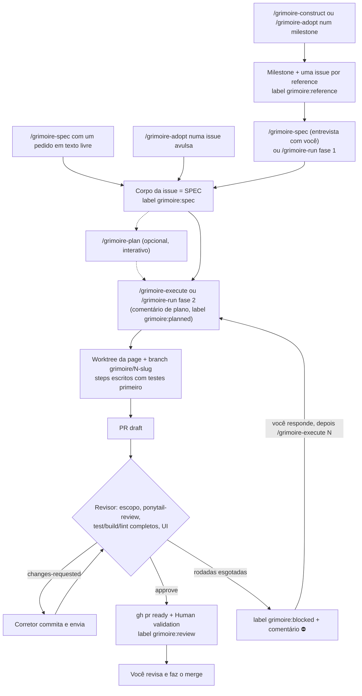
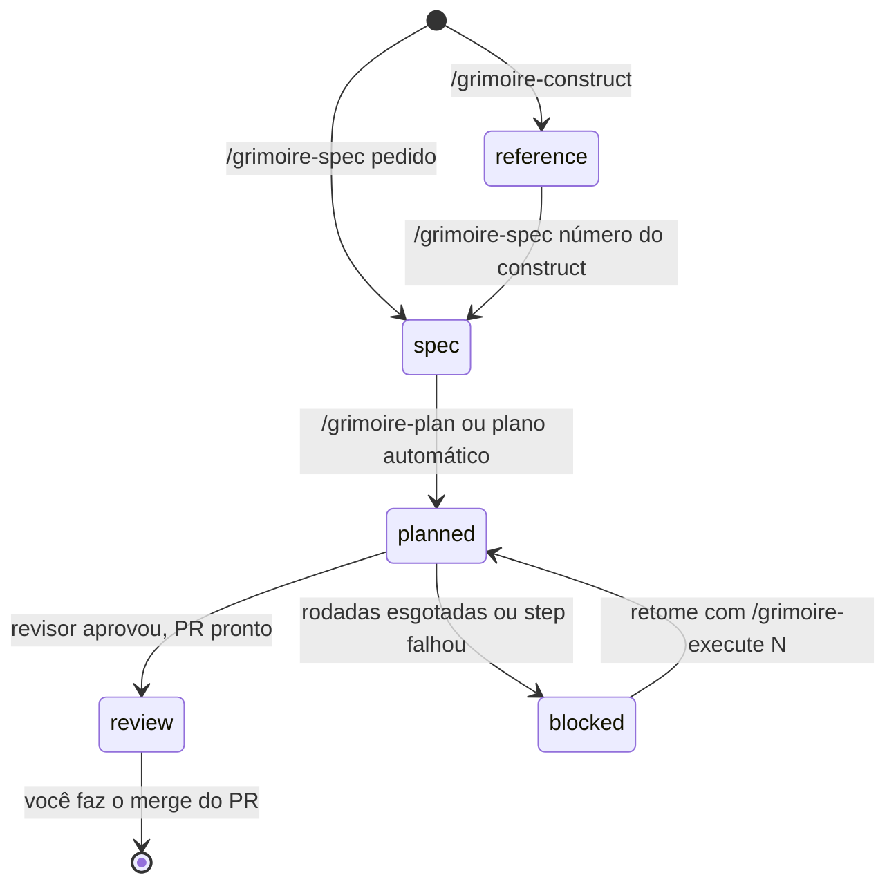

<div align="center">


# Grimoire

[English](README.md) · **Português (Brasil)**

</div>

Grimoire é um conjunto de treze skills para **Claude Code** e **Codex** que conduz um fluxo disciplinado **Spec → Plan → Execute**. Você fica no circuito onde importa — a entrevista de spec — e a partir dali o Grimoire planeja o trabalho, implementa com testes primeiro numa branch própria dentro de um worktree isolado, e conduz um **loop de revisão autônomo** (um revisor e um corretor, rodada após rodada) que termina num pull request aguardando a **sua** revisão. O `grimoire-run` faz o mesmo para um **construct** inteiro — um objetivo maior dividido em pages ordenadas —, entrevistando você primeiro e depois executando cada page sozinho. O estado do fluxo vive em **milestones, issues e pull requests do GitHub** — nunca é commitado no seu repositório (um modo local, ignorado pelo git, atende repositórios sem GitHub).

> [!WARNING]
> **Desenvolvimento inicial.** O Grimoire funciona nas sessões do dia a dia do autor, mas ainda não foi testado em muitos projetos ou equipes. Espere arestas e quebras de compatibilidade entre versões menores. Issues e PRs são muito bem-vindos.

## Por que Grimoire

Eu construí o Grimoire porque outros orquestradores de contexto vinham me dando resultados medíocres — pesados demais, falantes demais e ávidos demais por tomar decisões no meu lugar. O resultado costumava ser um projeto que se afastava do que eu realmente queria.

O Grimoire é o oposto. Ele pergunta até **você** ter clareza do que quer, e aí entrega exatamente isso: toda page começa com uma entrevista que termina numa especificação acordada, e toda escolha que o planejador faz por conta própria fica registrada como uma premissa que você lê no plano. Com a especificação acordada, o resto é autônomo — plano, implementação com testes primeiro, revisão, correções — e para num pull request com uma seção **Human validation** listando o que você ainda precisa verificar à mão. O Grimoire nunca faz o merge por você.

**Não é uma ferramenta para pessoas não-técnicas.** Ela assume que você sabe ler código, avaliar um plano e bancar as decisões que ela traz à tona.

> Toda alteração rastreada pelo Grimoire é uma **page** — no GitHub, uma issue cujo corpo é a especificação e cujo trabalho é entregue como um único pull request. Um objetivo grande demais para uma page é um **construct** — um milestone cujas issues são **references** ordenadas, cada uma especificada depois como uma page.

## agentes.chat

Os bots gerenciados usam o catálogo do workspace, sem instalar pastas de skills do CLI. Importe/atualize as 13 entradas `skills/grimoire-*` pelo app; o bootstrap lê o adaptador e as convenções da mesma release e resolve importações em que `${GRIMOIRE_HOME}` não foi substituído. As auxiliares de `deps.txt` e o executável/runtime do navegador precisam de verificação separada. O [adaptador](AGENTES-CHAT.md) documenta ferramentas, dependências, permissões e atualização dos bots.

O armazenamento dos constructs é independente do armazenamento das pages:

```toml
# .grimoire/config.toml
[constructs]
backend = "agentes-chat"
```

Cada construct é um documento nativo no Drive com a lista ordenada de references e uma tarefa do quadro por seed. Não exige milestone no GitHub. `/grimoire-spec ac:<UUID-do-documento>` expande a próxima reference numa page normal no GitHub/local; `/grimoire-run ac:<UUID-do-documento>` executa o mesmo pipeline, e `/grimoire-construct-update ac:<UUID-do-documento>` altera a cauda pendente. IDs estáveis, backlinks tipados das pages e reconciliação nas retomadas preservam a ordem e o prefixo travado. O compartilhamento segue a conversa, salvo autorização para outro público.

O padrão `backend = "auto"` preserva os constructs GitHub/locais existentes; atualizar skills não os migra. Pages no GitHub podem usar o conector sem `gh`; o modo nativo atende conectores sem milestones. Os cartões do app continuam controlando publicação, envio para revisão, merge e deploy. A atualização gerenciada usa `update_skill_from_source` apenas nas entradas do Grimoire, sem executar `install.sh`; propostas pendentes são reportadas como pendentes.

## Instalação

**macOS, Linux, Git Bash:**

```sh
curl -fsSL https://raw.githubusercontent.com/ojCezarFerreira/grimoire/main/install.sh | sh
```

Passe flags depois de `sh -s --`, por exemplo `… | sh -s -- --agent codex --no-deps`.

**Windows PowerShell** (requer o [Git for Windows](https://git-scm.com/download/win); o script executa o `install.sh` pelo `bash.exe` dele):

```powershell
irm https://raw.githubusercontent.com/ojCezarFerreira/grimoire/main/install.ps1 | iex
```

Para passar flags no Windows, rode a linha `curl … | sh -s -- <flags>` no Git Bash.

**A partir de um checkout** (modo de desenvolvimento — o próprio checkout é o home do Grimoire; nada é clonado, e `--ref`, `--home` e `GRIMOIRE_HOME` são ignorados com um aviso):

```sh
git clone https://github.com/ojCezarFerreira/grimoire.git
cd grimoire
./install.sh            # Windows PowerShell: .\install.ps1 -- <flags>
```

**Requisitos.** `git` (exceto no modo de desenvolvimento); Claude Code e/ou Codex — um agente é detectado quando `~/.claude` / `~/.codex` existe ou `claude` / `codex` está no `PATH`, e o instalador para quando nenhum é encontrado e nenhum `--agent` é passado; Node.js com `npx` / `npm` para as dependências (sem ele, elas são puladas com um aviso). Em tempo de execução, o backend GitHub precisa de acesso autenticado ao repositório pela CLI [`gh`](https://cli.github.com/) ou por um conector GitHub com as operações necessárias. Operações de milestones são verificadas separadamente.

**Codex.** O sandbox padrão `workspace-write` do Codex bloqueia a rede (necessária para `gh`, `git fetch`, `git push`) e mantém o `.git` somente leitura, então commits, `git worktree add` e a criação de branches falham. As skills que escrevem objetos no GitHub, fazem push, fazem commit ou criam branches e worktrees — `/grimoire-spec`, `/grimoire-plan`, `/grimoire-execute`, `/grimoire-run`, `/grimoire-adopt`, `/grimoire-construct`, `/grimoire-construct-update`, `/grimoire-init` (labels, commit da documentação), `/grimoire-note`, `/grimoire-quick`, `/grimoire-deps` (ao aplicar atualizações), `/grimoire-update` — precisam de acesso à rede mais um sandbox que permita escrever no `.git`, ou do Codex iniciado com `--dangerously-bypass-approvals-and-sandbox` / `-s danger-full-access`. Sem isso, as fases que não fazem perguntas viram pedidos de aprovação, ou a página termina `blocked`. Mesmo com o sandbox desligado, a revisão automática de aprovações do Codex pode recusar o `rm -rf` de uma pasta de worktree que sobrou depois de `git worktree remove --force` (`git worktree prune` e a conferência de `git worktree list` ainda vêm em seguida); nesse caso a execução informa o caminho exato dessa pasta para você apagar à mão, em vez de falhar. Só o acesso à rede é `-c sandbox_workspace_write.network_access=true`; para configurar em toda sessão:

```toml
# ~/.codex/config.toml
sandbox_mode = "danger-full-access"   # what -s danger-full-access does: network and .git writes

# or keep workspace-write and allow only the network (commits and branch / worktree creation still fail):
# sandbox_mode = "workspace-write"
# [sandbox_workspace_write]
# network_access = true
```

**Execuções headless.** Sob `claude -p` (modo print), o Claude Code interrompe os sub-agentes em segundo plano dez minutos depois do último turno do orquestrador, a menos que `CLAUDE_CODE_PRINT_BG_WAIT_CEILING_MS=0` esteja definido — defina-o para `/grimoire-execute` e `/grimoire-run` sem supervisão. Execuções sem supervisão também precisam de `--dangerously-skip-permissions` (ou de uma allowlist de permissões equivalente). No Git Bash, prefixe o comando com `MSYS_NO_PATHCONV=1` (ou escreva `//grimoire-execute N`) para que o MSYS não reescreva `/grimoire-…` como um caminho do Windows. Sessões interativas não são afetadas.

### Flags

| Flag | Significado |
|---|---|
| `--ref <tag\|branch>` | Versão a instalar. Padrão: a última tag de release `v*`; `main` = edge. |
| `--agent claude\|codex` | Instala só para este agente. Repetível; sobrepõe a detecção. |
| `--no-deps` | Pula as dependências de terceiros listadas em `deps.txt`. |
| `--dry-run` | Mostra cada ação, não escreve nada. |
| `--uninstall [--purge]` | Remove as skills `grimoire-*`; `--purge` também apaga o home do Grimoire. |
| `--home <dir>` | Home do Grimoire. Padrão: `$GRIMOIRE_HOME`, senão `$HOME/.grimoire`. |
| `-h`, `--help` | Mostra a ajuda. |

Ambiente: `GRIMOIRE_HOME` (igual a `--home`) e `GRIMOIRE_REPO` (a URL git clonada no modo remoto; padrão `https://github.com/ojCezarFerreira/grimoire.git`).

### O que é instalado

| O quê | Onde |
|---|---|
| Home do Grimoire — um clone deste repositório (`GRIMOIRE-CONVENTIONS.md`, `VERSION`, `install.sh`, `deps.txt`, …), marcado com `git config grimoire.managed true` | `~/.grimoire` (`--home` / `GRIMOIRE_HOME`) |
| As 13 skills para o Claude Code | `~/.claude/skills/grimoire-*` |
| As 13 skills para o Codex | `~/.agents/skills/grimoire-*` |
| Configuração global, copiada de `config.example.toml` uma vez e nunca sobrescrita | `~/.grimoire/config.toml` |

As skills são **cópias**, não symlinks: cada execução apaga as pastas das skills do Grimoire instaladas e as copia de novo (uma pasta `grimoire-*` cujo `SKILL.md` não nomeia uma skill distribuída é mantida, com um aviso), substituindo o token `${GRIMOIRE_HOME}` em cada arquivo de skill pelo caminho absoluto do home. O instalador avisa quando o plugin 0.13 do Claude Code ainda está instalado, e termina com um resumo (versão, home, agentes, skills, dependências, config, próximos passos).

### Dependências

Instaladas a partir das fontes upstream — **nunca empacotadas**. O `npx skills add --skill` copia só a pasta da skill, então o arquivo de licença pode não vir junto: a licença de cada dependência fica no repositório upstream dela (linkado abaixo). As skills são instaladas com `npx -y skills add <source> --skill <name> -g -y -a <claude-code|codex>` (mais `--copy` no Windows); a CLI com `npm install -g agent-browser` quando ela ainda não está no `PATH`, seguido de `agent-browser install`. Uma dependência que falha é um aviso, nunca um erro: sem o `ponytail-review` o revisor faz ele mesmo as mesmas seis perguntas e avisa; sem `agent-browser`, `impeccable` ou `revenue-centric-design` ele registra aquela checagem de UI como "not verified" em human validation.

| Dependência | Fonte | Licença | Usada para |
|---|---|---|---|
| skill `ponytail-review` | [DietrichGebert/ponytail](https://github.com/DietrichGebert/ponytail) | MIT | A checagem de code review do revisor (correto, seguro, aguenta carga, testado, rápido, enxuto). |
| skill `revenue-centric-design` | [heliocosta-dev/revenue-centric-design](https://github.com/heliocosta-dev/revenue-centric-design) | Source-available — exige atribuição, proíbe uso em produtos de apostas / jogos de azar (veja o `LICENSE` dela) | Lente de revisão de UI só em superfícies de conversão, onboarding, pricing e checkout. |
| skill `impeccable` | [pbakaus/impeccable](https://github.com/pbakaus/impeccable) | Apache-2.0 | Lente de revisão de UI: hierarquia, acessibilidade, consistência. |
| skill + CLI `agent-browser` | [vercel-labs/agent-browser](https://github.com/vercel-labs/agent-browser) (npm `agent-browser`) | Apache-2.0 | Abrir as rotas alteradas num navegador durante a revisão de UI: snapshot de acessibilidade, erros de console, screenshots. |

### Atualização

Rode `/grimoire-update`. Ele compara a `VERSION` instalada com a mais recente no GitHub, mostra o delta do changelog e, com o seu ok, executa ele mesmo `sh ~/.grimoire/install.sh --ref v<latest>` (ou o `install.sh` do seu `--home`); depois abra uma sessão nova. Rodar de novo a linha `curl … | sh` faz o mesmo. Um checkout de desenvolvimento é atualizado à mão: `git pull`, depois `./install.sh`.

### Desinstalação

```sh
sh ~/.grimoire/install.sh --uninstall            # remove as skills grimoire-* dos dois agentes
sh ~/.grimoire/install.sh --uninstall --purge    # ...e apaga ~/.grimoire (config global incluída)
```

Com um `--home` personalizado, rode o `install.sh` que está dentro dele. `curl … | sh -s -- --uninstall [--purge]` também funciona. O `--purge` só apaga um home que o instalador clonou — nunca um checkout de desenvolvimento. As dependências ficam onde estão; o instalador imprime os comandos que as removem (`npx skills remove <name> -g`, `npm uninstall -g agent-browser`).

## Migrando do 0.13

O 0.13 era um plugin do Claude Code que commitava o próprio estado (`.grimoire/HISTORIC.md`, pastas de page e de construct) no seu repositório. O 0.14 é instalado pelo instalador e mantém esse estado fora do git.

1. Remova o plugin:

   ```sh
   claude plugin uninstall grimoire@grimoire
   claude plugin marketplace remove grimoire
   ```

2. Rode o instalador (acima).
3. Rode `/grimoire-init` em cada projeto. Quando ele encontra estado do 0.13 rastreado pelo git (`.grimoire/pages/`, `.grimoire/constructs/`, `.grimoire/HISTORIC.md`, `.grimoire/bag/historic/`), ele propõe a migração e pede o seu consentimento — **nunca em silêncio**, e você pode recusar. Aceita, ela grava um frontmatter `status:` em toda page e construct legados (a partir das entradas do `HISTORIC.md`: `[spec]` → `spec`, `[planned]` → `planned`, `[finished]` → `done`), deixa de rastrear as pastas que agora são ignoradas pelo git (elas continuam no disco), apaga o `HISTORIC.md` e o `bag/historic/`, e commita `chore(grimoire): migrate to 0.14 layout`. No backend GitHub, as pages ainda em andamento deixam de ser endereçáveis pelo número (os números agora são números de issue): especifique-as de novo com `/grimoire-spec`, colando o `SPEC.md` delas. A mesma execução converte um `PROJECT.md` anterior ao 0.14: as seções dele alimentam os arquivos de `docs/` que faltam e o novo índice `PROJECT.md`.

## Skills

| Skill | O que faz | Argumento |
|---|---|---|
| [`/grimoire-init`](#grimoire-init) | Analisa o projeto, entrevista você e escreve `docs/`, o índice `.grimoire/PROJECT.md` e `.grimoire/config.toml`; migra repositórios 0.13. | contexto extra ou áreas de foco (opcional) |
| [`/grimoire-spec`](#grimoire-spec) | Entrevista você até o consenso e escreve o SPEC de uma page — uma issue no GitHub (`grimoire:spec`) ou um `SPEC.md` local; com um número de construct puro, especifica a próxima reference dele. | o pedido da page, ou um número de construct |
| [`/grimoire-plan`](#grimoire-plan) | Planejador interativo opcional: escreve o plano de steps como um comentário de plano (`grimoire:planned`) ou como arquivos de step locais. | número da page |
| [`/grimoire-execute`](#grimoire-execute) | Planeja sozinho se preciso, executa os steps num worktree da page, abre um PR draft e roda rodadas de revisão até o PR ficar pronto para você ou a page ficar bloqueada. Não faz perguntas. | número da page |
| [`/grimoire-run`](#grimoire-run) | Executa um construct inteiro: entrevistas de spec primeiro, depois cada page de forma autônoma, em ondas de dependência com PRs empilhados. | construct (número / título do milestone, ou `NNN` / nome localmente) |
| [`/grimoire-construct`](#grimoire-construct) | Decompõe um objetivo grande demais num construct: um milestone com uma issue `grimoire:reference` por reference, em ordem. | um objetivo, ou o caminho de um construct brief |
| [`/grimoire-construct-update`](#grimoire-construct-update) | Adiciona, remove, reordena ou edita references pendentes, reescreve a introdução ou renomeia um construct; references já especificadas ficam travadas. | número ou nome do construct, mais a alteração |
| [`/grimoire-adopt`](#grimoire-adopt) | Coloca uma issue (→ page) ou um milestone (→ construct) já existentes no GitHub sob a gestão do Grimoire. Só GitHub. | issue (`42` / `#42`) ou milestone (`milestone 3` / `m3` / título) |
| [`/grimoire-quick`](#grimoire-quick) | Correção pequena na sua branch atual: porteiro de escopo, um plano que você autoriza, um sub-agente com TDD. Sem page. | descrição da tarefa / correção |
| [`/grimoire-know`](#grimoire-know) | Responde perguntas sobre o repositório ou a aplicação — somente leitura, com pesquisa na web e citações quando preciso. | sua pergunta |
| [`/grimoire-note`](#grimoire-note) | Incorpora uma nota em texto livre ao `docs/conventions.md` ou às `## Grimoire rules` do `PROJECT.md`, sem duplicatas e consolidada. | nota(s) em texto livre |
| [`/grimoire-deps`](#grimoire-deps) | Audita dependências (CVEs, risco de semver, maturidade, reputação), aplica os bumps seguros que você escolher, um commit cada, e encaminha os que quebram para o `/grimoire-spec`. | pacote ou ecossistema (opcional) |
| [`/grimoire-update`](#grimoire-update) | Atualiza a instalação do Grimoire: mostra o delta do changelog e roda o instalador com o seu ok. | nenhum |

## Skills em detalhe

Toda skill lê o `GRIMOIRE-CONVENTIONS.md` e os dois arquivos de configuração antes de começar e — exceto o `/grimoire-update` — o índice `.grimoire/PROJECT.md` do projeto e os docs que ele aponta. As skills que lidam com pages, constructs ou PRs (e o `/grimoire-init`) então detectam o backend e o anunciam (`🔗 Backend: GitHub (owner/repo)` ou `📁 Backend: local`). As mensagens chegam a você no seu idioma; arquivos, issues, PRs e commits ficam em inglês.

### /grimoire-init

Rode uma vez por projeto, e de novo sempre que o projeto mudar de forma relevante. Ele lê o README, os manifestos, a configuração de build e de CI e o layout de primeiro nível; descobre os comandos de install, dev, test, build e lint (pelo lockfile, scripts do `package.json`, `Makefile`, `pyproject.toml`, … — lidos, nunca executados), usando um placeholder `{port}` quando o dev server aceita uma flag de porta; e pergunta só o que não consegue inferir — propósito, público, estágio, convenções, regras para os agentes do Grimoire, o idioma dos docs, comandos que faltam.

Depois de uma única revisão do rascunho, ele escreve:
- **`docs/`** — documentação neutra do projeto, sem vocabulário do Grimoire: `overview.md`, `architecture.md`, `conventions.md`, `development.md`. Quando `docs/` já existe, ele só propõe os que faltam e nunca reescreve os seus.
- **`.grimoire/PROJECT.md`** — um índice: uma linha por arquivo de `docs/*`, depois `## Grimoire rules` (como os agentes devem se comportar neste repositório).
- **`.grimoire/config.toml`** — `[verify]` e `[docs]`.
- **`.gitignore`** — um bloco `# Grimoire` ignorando `.grimoire/pages/`, `.grimoire/constructs/`, `.grimoire/bag/`.

No GitHub ele também cria os labels `grimoire:*`. Com um `PROJECT.md` existente ele roda em **modo de atualização** e pergunta só o que mudou, mantendo todo valor de configuração existente. Ele também propõe a [migração do 0.13](#migrando-do-013) quando ela se aplica. Commit: `docs(grimoire): initialize project context` (ou `update project context`).

### /grimoire-spec

O ponto de entrada. Passe um pedido em texto livre; um sub-agente de pesquisa analisa o código relevante, depois o Grimoire entrevista você — objetivos, não-objetivos, escopo, critérios de aceitação, restrições, perguntas em aberto — até vocês concordarem, e apresenta o SPEC para revisão. No GitHub o SPEC vira uma **issue** com o label `grimoire:spec` (o número da issue é o número da page); localmente, `.grimoire/pages/NNN-<slug>/SPEC.md` com `status: spec`.

Se o pedido é grande demais para uma page, ele recomenda um construct; com a sua aprovação, escreve um handoff brief em `.grimoire/bag/drafts/construct-brief-<epoch>.md` e para, para você rodar `/grimoire-construct` com ele numa sessão nova. Recebendo **só um número**, ele consome a primeira reference pendente daquele construct: a reference alimenta a entrevista completa, e a própria issue da reference vira a page (com o label trocado para `grimoire:spec`); localmente, a reference passa a `specced`. Não commita nada. Próximo passo: `/grimoire-plan <n>` ou `/grimoire-execute <n>`.

### /grimoire-plan

Opcional — use quando quiser conduzir o plano; caso contrário o `/grimoire-execute` planeja sozinho. Ele para com uma mensagem clara quando a page não existe, é uma issue não gerenciada pelo Grimoire (→ `/grimoire-adopt`), ainda é uma reference, já está em execução ou em revisão, ou já foi finalizada. Ele pergunta sobre o que o SPEC deixou ambíguo, escolhe o número de steps pelo contexto que cada um precisa e — só quando alguns steps são de fato independentes — adiciona frontmatter `depends-on` / `touches` para que rodem em ondas paralelas, mostrando as ondas para você antes de escrever qualquer coisa. Toda decisão que ele tomou sozinho vai para `## Assumptions`.

Depois da revisão, no GitHub ele posta o **comentário de plano** (`## Assumptions` mais um bloco recolhido por step) e troca o label para `grimoire:planned`; localmente escreve o `PLAN.md` e os arquivos de step e marca `status: planned`. Uma page planejada que ainda não tem branch pode ser replanejada. Não commita nada.

### /grimoire-execute

Leva uma page de `spec` ou `planned` até um pull request aguardando a sua revisão — e **não pergunta nada** no caminho. A sessão é um orquestrador puro: todo plano, step, revisão e correção roda num sub-agente.

1. **Checagens** — para em page inexistente, não gerenciada, não especificada, em revisão ou finalizada; em page de dependência nunca executada ou bloqueada; em dependências entre steps cíclicas ou pendentes.
2. **Plano automático** — uma page ainda em `spec` é planejada por um sub-agente sem entrevista; as escolhas em aberto viram `## Assumptions` no comentário de plano.
3. **Branch e worktree** — branch `grimoire/<N>-<slug>` num worktree próprio, `.grimoire/bag/worktrees/page-<N>/`, criada a partir da branch padrão (localmente: a branch que está em checkout), ou **empilhada** sobre a branch de uma dependência cujo PR ainda não foi mergeado. A sua árvore de trabalho nunca troca de branch.
4. **Steps** — um sub-agente por step, com testes primeiro e commits atômicos, estritamente em ordem ou em ondas paralelas. Depois do primeiro commit a branch é enviada e um **PR draft** é aberto (`Closes #N`).
5. **Loop de revisão** — até `[review].max_rounds` (padrão 3). A cada rodada um revisor novo checa **(a)** o escopo contra cada critério de aceitação, **(b)** `ponytail-review`, **(c)** o `test_command` + `build_command` + `lint_command` completos e **(d)** a UI, quando um arquivo alterado casa com `[review].ui_globs`: um dev server novo no worktree da page, `agent-browser`, `impeccable`, `revenue-centric-design` em superfícies de conversão e conformidade com o seu próprio design system. `changes-requested` → um corretor commita e envia, e a próxima rodada começa.
6. **Resultado** — `approve`: o revisor escreve `## Summary` e `## Human validation` no corpo do PR, o PR é marcado como pronto (`gh pr ready`) e o label vira `grimoire:review`. Rodadas esgotadas (ou um step que falhou): `grimoire:blocked`, o PR continua draft e um comentário `⛔` lista os achados não resolvidos e o caminho de volta — responda na issue ou no PR e rode `/grimoire-execute N` de novo.

Rodar de novo numa page cuja branch já existe **retoma** a execução (`▶ Resuming page N on existing branch …`): os seus comentários novos vão para o corretor e para o revisor, e a revisão recomeça na rodada 1. Os worktrees são sempre desmontados no fim; a branch fica. Ele nunca apaga uma branch e nunca fecha um PR. Localmente, o PR é substituído pela branch mais o `REVIEW.md`.

### /grimoire-run

Executa um construct inteiro. **A fase 1 é interativa:** uma entrevista do `/grimoire-spec` por reference pendente, em ordem — responda "skip the rest" a qualquer momento para deixar as references restantes (e o que depende delas) para depois. Então ele imprime `🚀 Autonomous phase: N pages, K waves — you can leave.` e **não pergunta mais nada**.

A **fase 2** monta o grafo de dependências das pages (os `depends-on` das pages, ou uma cadeia implícita na ordem da lista quando nenhuma page tem um), executa-o em ondas com até `[run].page_parallelism` pages por vez (padrão 2) e leva cada page pelo mesmo protocolo do `/grimoire-execute` — pages dependentes ganham **PRs empilhados**; ele nunca espera um merge. Uma page bloqueada pula as suas dependentes enquanto as independentes continuam; um sub-agente que estoura o tempo ou quebra ganha uma nova tentativa. O progresso fica num ledger, `.grimoire/bag/runs/<construct>-<epoch>.md`; invocar a skill de novo retoma uma execução inacabada (`▶ Resuming run <id>`) sem reentrevistar. Ele termina com uma tabela de todas as pages — PR, estado, ordem de merge e onde estão os passos de validação humana.

### /grimoire-construct

Para objetivos grandes demais para uma page — normalmente alimentado pelo handoff brief que o `/grimoire-spec` escreveu. Sub-agentes de pesquisa decompõem o objetivo numa lista ordenada de **references do tamanho de uma page**, com `depends-on` onde algumas são de fato independentes; você confirma a ordem e as dependências numa entrevista e revisa o rascunho. No GitHub ele cria um **milestone** (introdução mais uma lista numerada `## References`) e **uma issue por reference na hora**, com o label `grimoire:reference` — o número de cada issue é o futuro número da page. Localmente, escreve `.grimoire/constructs/NNN-<name>/` com `CONSTRUCT.md` e `references/N-<short-name>.md`. Ele apaga o brief ao terminar e não commita nada. Próximo passo: `/grimoire-spec <m>` (uma reference por vez) ou `/grimoire-run <m>` (todas).

### /grimoire-construct-update

Altera um construct existente no lugar: adiciona, remove ou reordena references na cauda pendente, reescreve a semente de uma reference pendente, reescreve a introdução ou renomeia o construct. Ele para quando o construct não existe (`❌ Construct N does not exist. Run /grimoire-construct first.`). As references já especificadas formam um **prefixo travado**: editar, remover ou reordenar uma delas — ou inserir antes de uma delas — é recusado com uma mensagem que nomeia a reference e a page dela. No GitHub uma reference removida sai do milestone, ganha `grimoire:dropped` e é fechada; os números de issue nunca mudam, só a ordem. Localmente a cauda pendente é renumerada de forma contígua e a pasta fica com backup até você aprovar. Não commita nada.

### /grimoire-adopt

Coloca trabalho que já existe no GitHub sob o Grimoire — **só no backend GitHub**. Passe uma issue (`42` / `#42`) ou um milestone (`milestone 3`, `m3` ou o título exato); ele recusa objetos fechados ou já gerenciados. Um sub-agente de pesquisa analisa o código contra o pedido, e depois ele entrevista você para afiar o escopo e os critérios de aceitação e, no caso de um milestone, a ordem, as dependências, as lacunas e as issues grandes ou pequenas demais. Depois da revisão:
- uma **issue** vira uma page: seções do SPEC, label `grimoire:spec`, o texto original guardado num bloco recolhido `Original issue text`;
- um **milestone** vira um construct no lugar: as issues dele viram references (com o texto original preservado), as lacunas viram novas issues de reference, e a descrição original fica guardada em `Original milestone description`. Uma issue absorvida só sai do milestone — o Grimoire nunca fecha as suas issues.

Uma issue grande demais para uma page recebe a mesma recomendação de construct do `/grimoire-spec`. Não commita nada.

### /grimoire-quick

Para correções pequenas que não merecem uma page. Se o pedido é grande demais, ele para e aponta você para o `/grimoire-spec`. Caso contrário, resolve qualquer ambiguidade restante, mostra um plano passo a passo e espera a sua autorização explícita; então um sub-agente implementa com testes primeiro e commits atômicos **na sua branch atual** — sem page, sem worktree, sem PR.

### /grimoire-know

Perguntas e respostas somente leitura sobre o repositório ou a aplicação que ele constrói. Um sub-agente de pesquisa somente leitura inspeciona só os arquivos de que precisa e pesquisa na web quando a resposta depende de fatos fora do repo. A resposta começa pela resposta em si, lista o que for incerto e termina com `References` quando a web foi usada. Ele nunca escreve arquivos, nunca commita e nunca toca em `.grimoire/`, `docs/` ou objetos do GitHub.

### /grimoire-note

Incorpora uma nota em texto livre ao contexto do projeto. A nota é dividida em regras e cada uma é encaminhada: **como o código é escrito aqui** → `docs/conventions.md`; **como os agentes do Grimoire devem se comportar aqui** → `## Grimoire rules` do `PROJECT.md`; as ambíguas são perguntadas. Cada regra é mesclada, reescrita ou generalizada contra o que já existe, no menor número de palavras possível, e toda execução também consolida as entradas existentes. Ele nunca adiciona seções, nunca mexe em outros docs e para quando o `PROJECT.md` não existe (`❌ .grimoire/PROJECT.md does not exist.` — rode `/grimoire-init` primeiro). Depois da revisão: um commit, `docs(grimoire): refine project context`.

### /grimoire-deps

Audita as dependências do projeto — npm / pnpm / yarn, pip / poetry / uv, composer, cargo, go mod (outros ecossistemas no melhor esforço), opcionalmente focado num pacote ou ecossistema. Um sub-agente somente leitura avalia cada uma em **segurança** (ferramentas nativas de audit cruzadas com bases de advisories), **risco de semver** (patch / minor / major), **maturidade** (uma release alvo com menos de 14 dias é marcada "let it mature") e **reputação** (pesquisa na web por pacotes sequestrados, comprometidos ou depreciados). Você recebe um relatório ordenado — cada linha `apply`, `wait` ou `plan-migration`, com um aviso de que são heurísticas, não garantias — e responde com as atualizações a aplicar.

Um sub-agente então aplica os bumps **um de cada vez**, cada um condicionado ao `test_command` / `build_command` / `lint_command` completos do projeto (ou ao `docs/development.md` quando não há `[verify]`): passou → um commit `chore(deps): bump <pkg> to <ver>`; falhou → aquele bump é revertido e o próximo segue. Upgrades que quebram viram um upgrade brief para o `/grimoire-spec`. Ele nunca cria uma page e nunca escreve `docs/`, `PROJECT.md` ou `config.toml`.

### /grimoire-update

Lê a `VERSION` instalada no home do Grimoire e a mais recente no GitHub; quando são iguais, diz isso e para. Caso contrário, mostra o delta do changelog, pede um sim explícito e executa `sh "<home>/install.sh" --ref v<latest>` — que atualiza o home, copia as skills de novo, atualiza as dependências e mantém o seu `config.toml` global — e então pede que você abra uma sessão nova. Um checkout de desenvolvimento recebe a orientação de `git pull` + `./install.sh`, e um home que não é um clone git recebe a linha de reinstalação. Não commita nada no seu projeto. No Codex, o acesso à rede e as escritas fora do workspace podem pedir a sua aprovação de sandbox.

## Como funciona

No GitHub, um construct é um milestone, references e pages são issues, planos e vereditos de revisão são comentários de issue / PR, e cada page é entregue como um único pull request:



O status de uma page — um label no GitHub, frontmatter `status:` localmente:



`blocked` convive com `grimoire:planned` no GitHub. `review` é onde o Grimoire para: o merge (que fecha a issue) é seu.

## Configuração

Dois arquivos TOML, mesclados **chave a chave** sobre os padrões embutidos — embutido < global < projeto:

| Arquivo | Escopo | Escrito por |
|---|---|---|
| `~/.grimoire/config.toml` | Os seus padrões pessoais (modelos, esforços, paralelismo) | O instalador, uma vez, a partir de `config.example.toml`; nunca sobrescrito |
| `.grimoire/config.toml` | O projeto — **commitado** | `/grimoire-init` (`[verify]`, `[docs]`); editável à mão |

Um valor inválido imprime um aviso de uma linha e cai no padrão, e chaves desconhecidas são ignoradas — a configuração nunca interrompe uma skill. Cada sub-agente roda sob um **papel**, resolvido pelo primeiro acerto em: papel do projeto → papel global → `default` do projeto → `default` global → papel embutido. Valores embutidos:

| Papel | Usado por | Claude Code | Codex |
|---|---|---|---|
| `session` | Só aviso — o modelo recomendado para a sessão | `fable` / `max` | `gpt-6-astra` / `max` |
| `default` | Qualquer papel não definido num arquivo | `opus` / `high` | `gpt-6.1-sol` / `max` |
| `research` | Análise somente leitura em spec, construct, construct-update, adopt, know, audit do deps | `fable` / `max` | `gpt-6-astra` / `max` |
| `plan` | Planejador automático do execute / run | `fable` / `max` | `gpt-6-astra` / `max` |
| `execute` | Executores de step | `opus` / `high` | `gpt-6.1-sol` / `max` |
| `fix` | Corretores do loop de revisão | `opus` / `high` | `gpt-6.1-sol` / `max` |
| `review` | Revisor | `opus` / `high` | `gpt-6.1-sol` / `max` |
| `quick` | `/grimoire-quick` | `opus` / `high` | `gpt-6.1-sol` / `max` |
| `deps` | Aplicação do `/grimoire-deps` | `opus` / `high` | `gpt-6.1-sol` / `max` |

Modelos: `fable`, `opus`, `sonnet`, `haiku` no Claude Code; `gpt-6-astra`, `gpt-6.1-sol`, `gpt-6.1-terra`, `gpt-6-luna` no Codex (ids mais novos passam direto). Esforços: `low`, `medium`, `high`, `xhigh`, `max`.

Um trecho do `config.example.toml`:

```toml
[agents.claude]
default  = { model = "opus",  effort = "high" }
research = { model = "fable", effort = "max" }

[run]
page_parallelism = 2            # 0 = unlimited
step_timeout_minutes = 45
review_timeout_minutes = 30

[review]
max_rounds = 3
ui_globs = ["src/**/*.{tsx,jsx,vue,svelte,css,scss}", "app/**", "components/**", "pages/**"]

[constructs]
backend = "auto"                # auto | github | local | agentes-chat

[github]
mode = "auto"                   # auto | on | off
label_prefix = "grimoire"
branch_prefix = "grimoire"

# Project-level sections: grimoire-init writes them into each project's .grimoire/config.toml.
# [verify]
# install_command = "pnpm install"
# dev_command = "pnpm dev --port {port}"     # {port} = port allocated per page
# dev_url = "http://localhost:{port}"
# test_command = "pnpm test"
# build_command = "pnpm build"
# lint_command = "pnpm lint"
#
# [docs]
# dir = "docs"
# language = "en"
```

`[github].mode = "auto"` escolhe o backend GitHub quando o `origin` está no `github.com` e o CLI autenticado ou conector consegue ler esse repositório; `on` exige o GitHub, `off` força o modo local. Com o placeholder `{port}` as pages são revisadas num navegador em paralelo; sem ele as revisões de UI são serializadas.

## Modo local

Sem um remote no GitHub ou um transporte GitHub autenticado — ou com `[github].mode = "off"` — as mesmas skills guardam os mesmos objetos como arquivos **ignorados pelo git** em `.grimoire/`: uma page é `.grimoire/pages/NNN-<slug>/` (`SPEC.md`, `PLAN.md`, arquivos de step, `REVIEW.md` e um `NOTES.md` opcional onde você deixa comentários para uma retomada), um construct é `.grimoire/constructs/NNN-<name>/` (`CONSTRUCT.md` + `references/`), e o status vive no frontmatter `status:` deles. O `/grimoire-execute` continua trabalhando numa branch `grimoire/NNN-<slug>` num worktree próprio e a envia quando existe um remote, mas **não abre PR**: o veredito e os passos de validação humana vão para o `REVIEW.md` da page, e você mesmo faz o merge da branch. O `/grimoire-adopt` é exclusivo do GitHub.

## Convenções

As regras que sustentam tudo vivem num só lugar, o [GRIMOIRE-CONVENTIONS.md](GRIMOIRE-CONVENTIONS.md); as skills referenciam as seções dele e nunca as repetem:

- **§ TDD** — Red → Green → Refactor com execuções de teste filtradas; a suíte completa do gate de revisão é a exceção documentada.
- **§ Code comments** — comente o incomum, não o rotineiro.
- **§ Harness adaptation** — como cada operação se traduz no Claude Code e no Codex; local de instalação e o token `${GRIMOIRE_HOME}`.
- **§ Sub-agent spawning** — o orquestrador nunca implementa; os sete papéis e quem os dispara.
- **§ Configuration** — os dois arquivos de config, precedência, resolução de papéis, o schema completo.
- **§ Skill composition** — como as skills descobrem e usam outras skills instaladas como auxiliares.
- **§ Parallel execution** — `depends-on` / `touches` de steps, ondas, worktrees de step, semântica de falha.
- **§ Commits** — Conventional Commits em inglês, só commits de código, regras de branch e PR.
- **§ Backends** — GitHub vs. local, identificadores, marcadores, labels, comentários de plano / veredito, corpo do PR, empilhamento, os comandos `gh`.
- **§ .grimoire/ layout** — o que é commitado (`PROJECT.md`, `config.toml`) e o que é ignorado pelo git; frontmatter de status local.
- **§ Documentation** — `docs/`, o índice `PROJECT.md`, quem os escreve, a ordem de leitura, a migração do 0.13.
- **§ Construct** — milestones e references, ordem de consumo, regras de alteração, o handoff brief.
- **§ Review loop** — worktree da page, modo de retomada, checagens do revisor, veredito, corretor, resultado.
- **§ Run** — `grimoire-run`: entrevistas, a fronteira autônoma, ondas de pages, ledger, retomada, watchdog.
- **§ IDE-aware review** — rascunhos abertos no seu editor em vez de colados no chat.
- **§ User-facing language** — fontes em inglês, mensagens exibidas no seu idioma.
- **§ Pause-point pattern** — cada pausa e cada parada, com a mensagem literal.

## Contribuindo

O Grimoire é jovem e opinativo, mas toda issue, PR e relato de bug é bem-vindo — especialmente casos de borda, mensagens estranhas e histórias do tipo "essa skill não fez o que eu esperava". As notas de manutenção estão no [CLAUDE.md](CLAUDE.md) e em [docs/](docs/development.md); rode `bash scripts/test-install.sh` antes de enviar mudanças no instalador.

## Licença

[MIT](LICENSE) © Cezar Ferreira. As dependências mantêm as próprias licenças (veja [Dependências](#dependências)).
